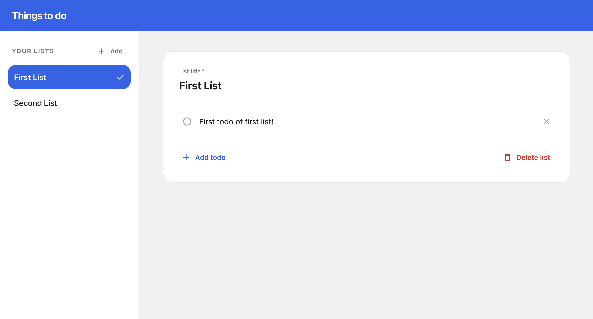

# Todo list

A small todo list app built with React and Express. Users can browse todo lists and add, edit, and delete the todos within them in the browser.

> This project started as a take-home assignment. The original brief is kept in [ASSIGNMENT.md](docs/assignment/ASSIGNMENT.md). Which and how the given tasks are solved is explained in [ASSIGNMENT_SOLUTION.md](docs/assignment/ASSIGNMENT_SOLUTION.md)



## Features

- Browse todo lists in a sidebar (a drawer on narrow screens); the selected list is highlighted in blue
- Open a list to edit its todos, add new ones, and delete existing ones
- Mark todos as completed or unmark them; completed todos are struck through and saved
- Create, rename, and delete todo lists
- Save list changes to SQLite so they survive page refreshes and backend restarts

## Architecture



### Frontend (`frontend/`)

- Vite single-page app using Material UI, with a shared blue/red/grey theme in `index.jsx`
- `TodoLists` ties the screen together
- `useTodoLists` hook loads and saves through `api.js`
- `TodoListOverview` is the sidebar that lists the todo lists
- `TodoListForm` edits the selected list
- Two dialogs create and delete lists

### Backend (`backend/`)

- Express server with CORS and JSON body parsing
- `app.js` sets up Express
- `todoListRoutes.js` exposes and validates the CRUD routes under `/api/todo-lists`
- `todoListStore.js` reads and writes lists and todos
- `database.js` opens the server-local SQLite file and sets up its tables

Design decisions are recorded in the [ADRs](docs/adr/).

The diagram source is [docs/diagrams/architecture.html](docs/diagrams/architecture.html).

## Tech stack

| Area | Technology |
| --- | --- |
| Frontend | React 18, Material UI 5, Vite |
| Backend | Node.js, Express 4, cors, SQLite |
| Linting | ESLint (`backend/`, `frontend/`), Prettier config in `.prettierrc` |

## Getting started

Requires Node.js; the version is pinned in [`.nvmrc`](.nvmrc). Start both packages:

```bash
# Backend, runs on http://localhost:3001
cd backend
npm ci
npm start

# Frontend, runs on http://localhost:3000
cd frontend
npm ci
npm start
```

- Lint each package with `npm run lint` from its folder
- The SQLite database is created automatically on first startup
- Optional environment variables:
  - `PORT` (backend): port to listen on, default `3001`
  - `TODO_DATABASE_PATH` (backend): where to store the SQLite file, default `backend/data/todo-lists.sqlite`
  - `VITE_API_URL` (frontend): backend base URL, default `http://localhost:3001`

## Project structure

```
backend/    Express server (src/index.js)
frontend/   React app (src/App.jsx, src/todos/components/)
docs/       Agent, desgin decision and other documentation
```

## Further reading

- [ASSIGNMENT.md](docs/assignment/ASSIGNMENT.md): the original assignment brief and tasks
- [docs/adr/](docs/adr/): architecture decision records
- [docs/agents/](docs/agents/): issue tracker, triage labels, and domain docs
