# Todo list

A small todo list app built with React and Express. Users can browse todo lists and add, edit, and delete the todos within them in the browser.

> This project started as a take-home assignment. The original brief is kept in [ASSIGNMENT.md](ASSIGNMENT.md).

## Features

- Browse a set of todo lists in a sidebar card
- Open a list to edit its todos, add new ones, and delete existing ones
- Create, rename, and delete todo lists
- Save list changes to SQLite so they survive page refreshes and backend restarts

## Architecture



The app is split into two parts:

- **Frontend** (`frontend/`): a Create React App single-page app using Material UI. `TodoLists` ties the screen together using the `useTodoLists` hook (which loads and saves through `api.js`), `TodoListOverview` lists the todo lists, `TodoListForm` edits the selected one, and two dialogs create and delete lists.
- **Backend** (`backend/`): an Express server with CORS and JSON body parsing. `app.js` sets up Express, `todoListRoutes.js` exposes and validates the CRUD routes under `/api/todo-lists`, `todoListStore.js` reads and writes lists and todos, and `database.js` opens the server-local SQLite file and sets up its tables.

The frontend's `api.js` client sends HTTP/JSON requests to the backend. Title and todo edits stay local until **Save**; creating or deleting a list sends a request immediately. All visitors share the same stored collection. There is no live synchronization: other browsers load the latest data on refresh.

The diagram source is [docs/diagrams/architecture.html](docs/diagrams/architecture.html).

## Tech stack

| Area | Technology |
| --- | --- |
| Frontend | React 18, Material UI 5, Create React App |
| Backend | Node.js, Express 4, cors |
| Linting | ESLint (`backend/`, `frontend/`), Prettier config in `.prettierrc` |

## Getting started

Requires Node.js. The version is pinned in [`.nvmrc`](.nvmrc).

```bash
# Backend, runs on http://localhost:3001
cd backend
npm ci
npm start

# Frontend, runs on http://localhost:3000
cd frontend
npm ci
npm start
```

Lint each package with `npm run lint` from its folder.

The backend stores todo lists in SQLite at `backend/data/todo-lists.sqlite` and creates the
database and its tables automatically on first startup. No separate database server or setup
command is required. The initial example lists are inserted once for a new database. To store the
database elsewhere, set `TODO_DATABASE_PATH` before starting the backend.

## Project structure

```
backend/    Express server (src/index.js)
frontend/   React app (src/App.jsx, src/todos/components/)
docs/       Agent and diagram documentation
```

## Further reading

- [ASSIGNMENT.md](ASSIGNMENT.md): the original assignment brief and tasks
- [docs/agents/](docs/agents/): issue tracker, triage labels, and domain docs
