# Todo schema uses cascade deletes and replace-all saves

Todos are stored as rows in a `todo` table that references `todo_list` with `ON DELETE CASCADE`, so deleting a list removes its todos in the same step; the delete confirmation dialog relies on this. Saving a list replaces all of its todos in one transaction instead of diffing them, because the form sends the whole list and this keeps ordering simple: the array index is stored as `position`.

